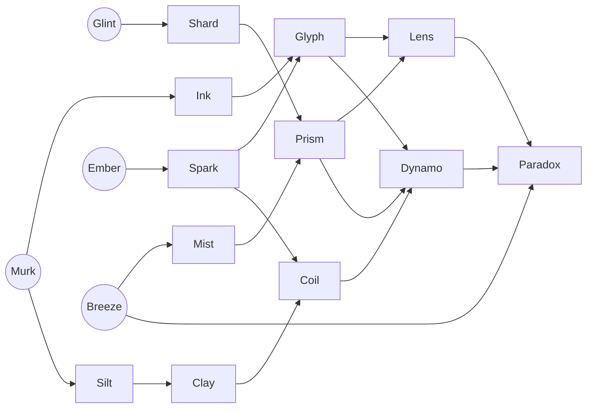
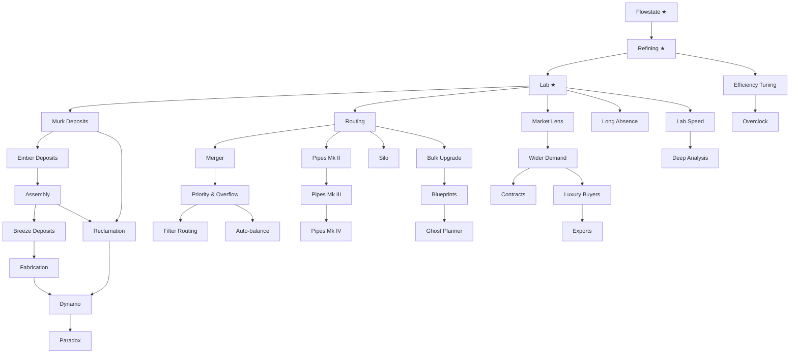

# Flowstate — Content & Numbers (v0.1)

All numbers are **first-pass placeholders** meant to be tuned in playtests. They're written so a prototype can load them directly as data. See [DESIGN.md](./DESIGN.md) for the rules these plug into.

---

## Materials

| Material | Tier | Shape · Color | Base value ¢ | Demand* | Source |
|---|---|---|---|---|---|
| Glint | T0 | ◆ yellow | 1 | 2.0/s | Glint Deposit |
| Murk | T0 | ● violet | 1 | 2.0/s | Murk Deposit |
| Ember | T0 | ▲ orange | 2 | 1.5/s | Ember Deposit |
| Breeze | T0 | ≈ cyan | 2 | 1.5/s | Breeze Deposit |
| Shard | T1 | ⬢ pale gold | 3 | 1.5/s | Refiner |
| Ink | T1 | ■ deep blue | 4 | 1.2/s | Refiner |
| Silt | T1 | · grey | 0.5 | 0.5/s | Refiner (byproduct) |
| Spark | T1 | ✦ red-orange | 6 | 1.0/s | Refiner |
| Mist | T1 | ☁ teal | 6 | 1.0/s | Refiner |
| Clay | T1 | ▬ brown | 3 | 0.8/s | Refiner |
| Prism | T2 | ◇ rainbow | 24 | 0.6/s | Assembler |
| Glyph | T2 | ✧ magenta | 20 | 0.6/s | Assembler |
| Coil | T2 | ⊚ copper | 22 | 0.5/s | Assembler |
| Lens | T3 | ◎ white | 130 | 0.25/s | Fabricator |
| Dynamo | T3 | ⚙ electric blue | 180 | 0.2/s | Fabricator |
| Paradox | T3★ | ∞ shifting | 750 | 0.1/s | Fabricator (capstone) |

\* **Demand** = sell rate at which that material's price halves: `price = value / (1 + rate / demand)`.

---

## Recipes

| Recipe | Machine | Inputs | Outputs | Time |
|---|---|---|---|---|
| Shard | Refiner | 2 Glint | 1 Shard | 2.0s |
| Ink | Refiner | 2 Murk | 1 Ink + 1 Silt | 2.0s |
| Spark | Refiner | 2 Ember | 1 Spark | 2.0s |
| Mist | Refiner | 2 Breeze | 1 Mist | 2.0s |
| Clay | Refiner | 3 Silt | 1 Clay | 3.0s |
| Prism | Assembler | 2 Shard + 1 Mist | 1 Prism | 4.0s |
| Glyph | Assembler | 1 Ink + 1 Spark | 1 Glyph | 3.0s |
| Coil | Assembler | 1 Spark + 2 Clay | 1 Coil | 4.0s |
| Lens | Fabricator | 1 Prism + 2 Glyph | 1 Lens | 6.0s |
| Dynamo | Fabricator | 2 Coil + 1 Glyph + 1 Prism | 1 Dynamo | 8.0s |
| Paradox | Fabricator | 1 Lens + 1 Dynamo + 4 Breeze | 1 Paradox | 12.0s |

Design notes:
- **Silt** is the deliberate nuisance byproduct: worth almost nothing, low demand, and it backs up Ink production if ignored. Early answer: Void it or fan it to the Market. Later answer: turn it into Clay → Coil. That's a full "problem → patch → elegant solution" arc in one material.
- **Glyph** is the hub material (feeds Lens *and* Dynamo), so it's the first place players need Ratio/Priority routing.
- **Paradox** re-uses raw Breeze, forcing a long-distance wire from the raw edge of the board to the T3 core — a layout challenge, not just a ratio one.

---

## Nodes (board purchases)

| Node | Base cost ¢ | Cost growth | Base rate / buffer | Upgrade tracks |
|---|---|---|---|---|
| Well | 10 | ×1.15 | 1.0/s (Ember/Breeze 0.8/s) | Speed |
| Refiner | 50 | ×1.15 | — | Speed, Efficiency, Buffer |
| Assembler | 400 | ×1.15 | — | Speed, Efficiency, Buffer |
| Fabricator | 5,000 | ×1.15 | — | Speed, Efficiency, Buffer |
| Router | 25 | ×1.10 | — | — |
| Merger | 25 | ×1.10 | — | — |
| Silo | 200 | ×1.20 | 200 items | Buffer |
| Market | 1st free, then 1,000 | ×2.0 | sells up to 5/s per Market | Throughput |
| Lab | 100 | ×1.30 | 1 item/s | Speed |
| Void | free | — | unlimited | — |

**Upgrades:** level cost = `0.5 × node base cost × 1.6^level`, max level 10 (raised to 25 by tech).
- Speed: −15% cycle time / +25% Well rate, multiplicative per level.
- Efficiency: every 6th → 5th → … → 3rd cycle consumes no inputs.
- Buffer: +100% internal buffer.

**Pipes:** Mk I 1/s (free) · Mk II 3/s (20¢/wire) · Mk III 8/s (300¢/wire) · Mk IV 20/s (4,000¢/wire).

**Plots:** start with 3×3 plots; plot *n* costs `100 × 2.2^n`. ~1 in 3 new plots contains a Deposit, weighted toward materials the player has unlocked but has few of.

---

## Data (research currency)

A Lab converts each item into Data of a tier:

| Item tier | Yields |
|---|---|
| T0 | 1 α |
| T1 | 3 α |
| T2 | 5 β |
| T3 | 8 γ |

---

## Tech tree

`★` = auto-granted by a milestone (part of onboarding, never bought).

| ID | Tech | Branch | Cost | Unlocks |
|---|---|---|---|---|
| — | Flowstate ★ | — | — | Glint Well, Market, wiring, fan-in/out |
| P1 | Refining ★ | Processing | 50¢ lifetime earned | Refiner, Shard |
| R1 | Lab ★ | Research | First Shard sold | Lab, Data, Tech Tree panel |
| P2 | Murk Deposits | Processing | 20α | Murk, Ink + Silt, Void node |
| P3 | Ember Deposits | Processing | 40α | Ember, Spark |
| P4 | Assembly | Processing | 80α | Assembler, Glyph |
| P5 | Breeze Deposits | Processing | 150α | Breeze, Mist, Prism |
| P6 | Reclamation | Processing | 60α + 20β | Clay, Coil |
| P7 | Fabrication | Processing | 300α + 150β | Fabricator, Lens |
| P8 | Dynamo | Processing | 200β + 40γ | Dynamo |
| P9 | Paradox | Processing | 400β + 150γ | Paradox (MVP capstone) |
| L1 | Routing | Logistics | 15α | Router: Even + Ratio |
| L2 | Merger | Logistics | 25α | Merger node: Fair + Priority |
| L3 | Pipes Mk II | Logistics | 40α | Mk II wires |
| L4 | Priority & Overflow | Logistics | 60α | Router modes |
| L5 | Silo | Logistics | 30α | Silo node |
| L6 | Filter Routing | Logistics | 100α + 20β | Router Filter mode (mixed streams) |
| L7 | Pipes Mk III | Logistics | 80β | Mk III wires |
| L8 | Pipes Mk IV | Logistics | 100γ | Mk IV wires |
| C1 | Market Lens | Commerce | 10α | Price/saturation gauges on Markets |
| C2 | Wider Demand | Commerce | 50α | +50% demand, all materials |
| C3 | Contracts | Commerce | 100α | Contract board |
| C4 | Luxury Buyers | Commerce | 100β | +25% value on T2+ |
| C5 | Exports | Commerce | 50γ | +100% demand, all materials |
| R2 | Lab Speed | Research | 30α | Labs 2× speed |
| R3 | Deep Analysis | Research | 60β | +50% Data per item |
| R4 | Long Absence | Research | 40α | Offline cap 2h → 8h |
| U1 | Efficiency Tuning | Processing | 80α | Efficiency upgrade track |
| U2 | Overclock | Processing | 100β | Upgrade cap 10 → 25 |
| S1 | Bulk Upgrade | Scale tools | 40α | Upgrade a whole selection at once |
| S2 | Blueprints | Scale tools | 120α | Save & stamp named layouts |
| S3 | Auto-balance | Scale tools | 150β | One-click: Router ratios match downstream demand |
| S4 | Ghost Planner | Scale tools | 80β | Place unbuilt ghost nodes that auto-buy when affordable |

**Tree shape rule:** at any moment the player should see **2–4 affordable-soon techs** across at least two branches, so research always feels like a choice.
