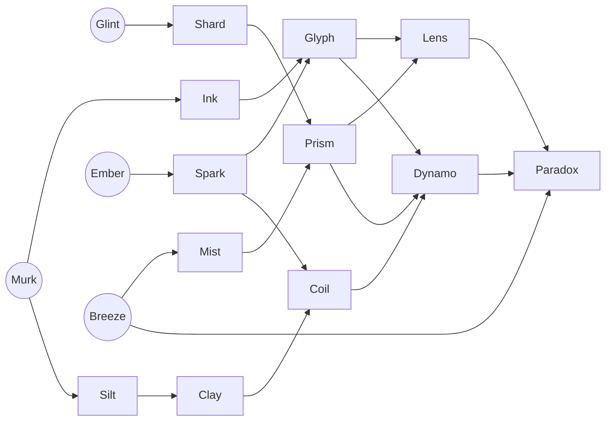

# Flowstate — Content & Numbers (v0.1)

All numbers are **first-pass placeholders** meant to be tuned in playtests. They're written so a prototype can load them directly as data. See [DESIGN.md](./DESIGN.md) for the rules these plug into.

---

## Materials

| Material | Tier | Shape · Color | Base value ¢ | Demand* | Source |
|---|---|---|---|---|---|
| Glint | T0 | ◆ yellow | 1 | 2.0/s | Glint Deposit |
| Murk | T0 | ● violet | 1 | 2.0/s | Murk Deposit |
| Ember | T0 | ▲ orange | 2 | 1.5/s | Ember Deposit |
| Breeze | T0 | ≈ cyan | 2 | 1.5/s | Breeze Deposit |
| Shard | T1 | ⬢ pale gold | 3 | 1.5/s | Refiner |
| Ink | T1 | ■ deep blue | 4 | 1.2/s | Refiner |
| Silt | T1 | · grey | 0.5 | 0.5/s | Refiner (byproduct) |
| Spark | T1 | ✦ red-orange | 6 | 1.0/s | Refiner |
| Mist | T1 | ☁ teal | 6 | 1.0/s | Refiner |
| Clay | T1 | ▬ brown | 3 | 0.8/s | Refiner |
| Prism | T2 | ◇ rainbow | 24 | 0.6/s | Assembler |
| Glyph | T2 | ✧ magenta | 20 | 0.6/s | Assembler |
| Coil | T2 | ⊚ copper | 22 | 0.5/s | Assembler |
| Lens | T3 | ◎ white | 130 | 0.25/s | Fabricator |
| Dynamo | T3 | ⚙ electric blue | 180 | 0.2/s | Fabricator |
| Paradox | T3★ | ∞ shifting | 750 | 0.1/s | Fabricator (capstone) |

\* **Demand** = sell rate at which that material's price halves: `price = value / (1 + rate / demand)`.

---

## Recipes

| Recipe | Machine | Inputs | Outputs | Time |
|---|---|---|---|---|
| Shard | Refiner | 2 Glint | 1 Shard | 2.0s |
| Ink | Refiner | 2 Murk | 1 Ink + 1 Silt | 2.0s |
| Spark | Refiner | 2 Ember | 1 Spark | 2.0s |
| Mist | Refiner | 2 Breeze | 1 Mist | 2.0s |
| Clay | Refiner | 3 Silt | 1 Clay | 3.0s |
| Prism | Assembler | 2 Shard + 1 Mist | 1 Prism | 4.0s |
| Glyph | Assembler | 1 Ink + 1 Spark | 1 Glyph | 3.0s |
| Coil | Assembler | 1 Spark + 2 Clay | 1 Coil | 4.0s |
| Lens | Fabricator | 1 Prism + 2 Glyph | 1 Lens | 6.0s |
| Dynamo | Fabricator | 2 Coil + 1 Glyph + 1 Prism | 1 Dynamo | 8.0s |
| Paradox | Fabricator | 1 Lens + 1 Dynamo + 4 Breeze | 1 Paradox | 12.0s |

Design notes:
- **Silt** is the deliberate nuisance byproduct: worth almost nothing, low demand, and it backs up Ink production if ignored. Early answer: Void it or fan it to the Market. Later answer: turn it into Clay → Coil. That's a full "problem → patch → elegant solution" arc in one material.
- **Glyph** is the hub material (feeds Lens *and* Dynamo), so it's the first place players need Ratio/Priority routing.
- **Paradox** re-uses raw Breeze, forcing a long-distance wire from the raw edge of the board to the T3 core — a layout challenge, not just a ratio one.

---

## Nodes (board purchases)

| Node | Base cost ¢ | Cost growth | Base rate / buffer | Upgrade tracks |
|---|---|---|---|---|
| Well | 10 | ×1.15 | 1.0/s (Ember/Breeze 0.8/s) | Speed |
| Refiner | 50 | ×1.15 | — | Speed, Efficiency, Buffer |
| Assembler | 400 | ×1.15 | — | Speed, Efficiency, Buffer |
| Fabricator | 5,000 | ×1.15 | — | Speed, Efficiency, Buffer |
| Router | 25 | ×1.10 | — | — |
| Merger | 25 | ×1.10 | — | — |
| Silo | 200 | ×1.20 | 200 items | Buffer |
| Market | 1st free, then 150 | ×1.5 | sells anything, no limit | — |
| Lab | 100 | ×1.30 | 1 item/s | Speed |
| Void | free | — | unlimited | — |

**Upgrades:** level cost = `k × node base cost × 1.6^level` (k = 0.5 Speed, 1.5 Efficiency, 0.4 Buffer). Speed caps at level 10 (25 with Overclock), Efficiency at 4, Buffer at 5.
- Speed: −15% cycle time / +25% Well rate, multiplicative per level.
- Efficiency: every 6th → 5th → 4th → 3rd cycle consumes no inputs.
- Buffer: +100% internal buffer.

**Pipes:** Mk I 2/s (free) · Mk II 5/s (20¢/wire) · Mk III 12/s (300¢/wire) · Mk IV 30/s (4,000¢/wire).

**Board:** starts with five deposits (2 Glint, Murk, Ember, Breeze). Expansion *n* costs `100 × 2.2^n`, alternately widens and deepens the board, and reveals 2–3 deposits from a fixed cycle.

---

## Data (research currency)

A Lab converts each item into Data of a tier:

| Item tier | Yields |
|---|---|
| T0 | 1 α |
| T1 | 3 α |
| T2 | 5 β |
| T3 | 8 γ |

---

## Tech tree

`★` = auto-granted by a milestone (part of onboarding, never bought). The source of truth is `src/content.ts`.

| ID | Tech | Branch | Cost | Requires | Unlocks |
|---|---|---|---|---|---|
| P1 | Refining ★ | Processing | earn 50¢ in total | — | Refiner, Shard |
| R1 | Lab ★ | Research | sell your first Shard | — | Lab, Data, Tech tree |
| P2 | Murk Deposits | Processing | 20α | R1 | Murk Wells, Ink + Silt, Void node |
| P3 | Ember Deposits | Processing | 40α | P2 | Ember Wells, Spark |
| P4 | Assembly | Processing | 80α | P3 | Assembler, Glyph |
| P5 | Breeze Deposits | Processing | 150α | P4 | Breeze Wells, Mist, Prism |
| P6 | Reclamation | Processing | 60α + 20β | P4 | Clay, Coil |
| P7 | Fabrication | Processing | 300α + 150β | P5 | Fabricator, Lens |
| P8 | Dynamo | Processing | 200β + 40γ | P6, P7 | Dynamo |
| P9 | Paradox | Processing | 400β + 150γ | P8 | Paradox (capstone) |
| U1 | Efficiency Tuning | Processing | 80α | P1 | Efficiency upgrade track |
| U2 | Overclock | Processing | 100β | U1 | Speed cap 10 → 25 |
| L1 | Routing | Logistics | 15α | R1 | Router node, Ratio mode |
| L3 | Pipes Mk II | Logistics | 40α | L1 | 5/s wires |
| L7 | Pipes Mk III | Logistics | 80β | L3 | 12/s wires |
| L8 | Pipes Mk IV | Logistics | 100γ | L7 | 30/s wires |
| L4 | Priority Routing | Logistics | 60α | L1 | Router Priority mode (fill #1, overflow to the rest) |
| L6 | Filter Routing | Logistics | 100α + 20β | L4 | Router Filter mode |
| L2 | Merger | Logistics | 25α | L1 | Merger (junction) node |
| L5 | Silo | Logistics | 30α | L2 | Silo node |
| C1 | Market Lens | Commerce | 10α | R1 | Exact prices in the Market inspector |
| C2 | Wider Demand | Commerce | 50α | C1 | +50% demand |
| C4 | Luxury Buyers | Commerce | 100β | C2 | +25% value on T2 and T3 |
| C5 | Exports | Commerce | 50γ | C4 | +100% demand |
| R2 | Lab Speed | Research | 30α | R1 | Labs 2× speed |
| R3 | Deep Analysis | Research | 60β | R2 | +50% Data per item |
| R4 | Long Absence | Research | 40α | R1 | Offline cap 2h → 8h |
| S1 | Bulk Upgrade | Scale tools | 40α | L1 | "all" button on upgrades |
| S3 | Auto-balance | Scale tools | 150β | S1, L4 | One-click Router weights |

**Designed but not built yet:** Contracts (C3), Blueprints (S2), Ghost Planner (S4).

**Tree shape rule:** at any moment the player should see **2–4 affordable-soon techs** across at least two branches, so research always feels like a choice.
